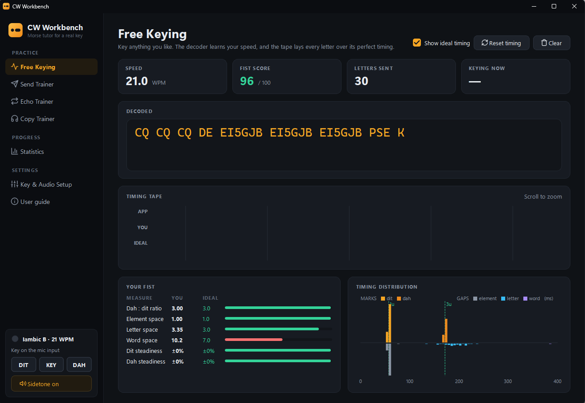
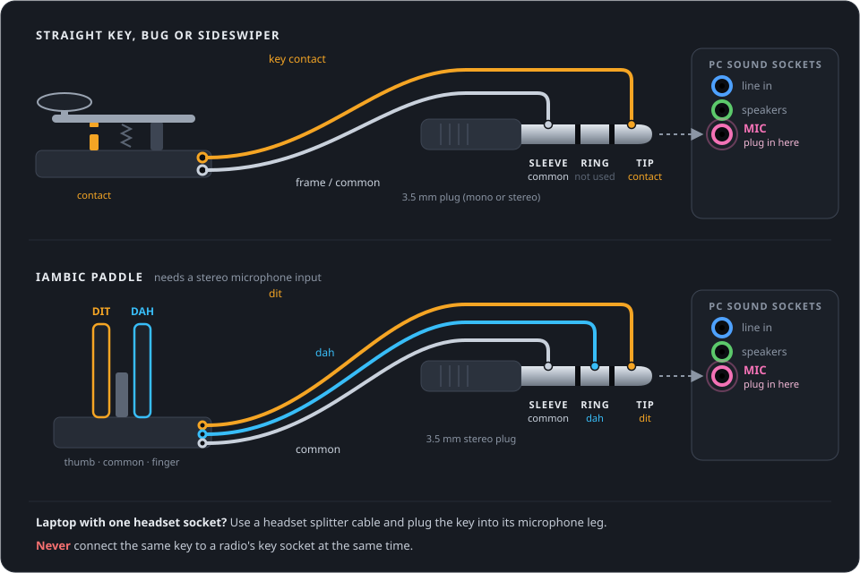

  

<h1 align="center">CW Workbench</h1>

  <b>A Morse code tutor for your real key.</b> 
  Plug a straight key, bug or iambic paddle into your PC's microphone socket and practise
  sending, copying and keying back, with instant sidetone and feedback on every letter.

  <a href="https://github.com/lmacc/CW-Workbench/releases/latest"><b>⬇ Download the latest version</b></a>
  &nbsp;·&nbsp; Windows 10 and 11 (64-bit)

## Why CW Workbench

Most Morse practice programs play code at you, or let you tap a keyboard key. CW Workbench
listens to **the key you use on the air**, plugged straight into the PC with an ordinary
3.5 mm plug. No interface box, no USB adapter.

- **Your own key, no extra hardware.** It detects the key through the microphone socket and
  calibrates itself to your sound card.
- **Radio-like keying.** A built-in iambic keyer (modes A and B) and a sidetone that follows
  your key within about 10 ms.
- **See your fist.** Every letter you send is drawn over its perfect timing, and a fist score
  rates your dah:dit ratio, spacing and steadiness.
- **Four ways to practise:**
  - **Free Keying**: send anything and watch it decoded.
  - **Send Trainer**: words, callsigns and QSO phrases, checked letter by letter.
  - **Echo Trainer**: hear it, then key it straight back.
  - **Copy Trainer**: the Koch method, one new character at a time.
- **Practice that follows your weak spots.** Characters you get wrong come up more often,
  and the statistics show your accuracy for every character.

## Download and install

1. Go to the **[latest release](https://github.com/lmacc/CW-Workbench/releases/latest)** and
   download **`CWWorkbench-Setup-<version>.exe`**.
2. Run it. It installs for your Windows account without needing administrator rights, and
   adds **CW Workbench** and the **CW Workbench User Guide** to the Start menu.
3. If Windows shows **"Windows protected your PC"**, click **More info** → **Run anyway**.
   The installer isn't code-signed, so Windows doesn't recognise it yet.

To update, run the newer installer. To remove the app, go to **Settings → Apps → Installed
apps → CW Workbench → Uninstall**.

## Connect your key

| Key | Tip | Ring | Sleeve |
|---|---|---|---|
| Straight key, bug, sideswiper | key contact | not used | common |
| Iambic paddle | dit | dah | common |

- **Desktop PC:** use the pink microphone socket.
- **Laptop with one headset socket:** use a headset splitter cable and plug the key into its
  microphone leg.
- **Paddles** need a stereo microphone input. Many PCs have one, and the app tells you if yours doesn't.

> **Safe for your PC.** The microphone socket supplies only a few volts through a resistor,
> so closing a key across it is harmless. **Never connect the same key to a radio at the
> same time.**

## First start

1. The app opens on **Key & Audio Setup**. Choose the microphone input your key is plugged
   into and tick **Read my key from this input**.
2. Press **Calibrate**: hands off for a moment, then press and hold the key, then release.
   It takes about 7 seconds (12 for a paddle).
3. On **Keyer & sound**, choose your key type, keyer speed and sidetone.
4. Go to **Free Keying** and start sending.

No key yet? Use the keyboard (**Space** is a straight key, **Ctrl** or **[ ]** are paddles)
or the on-screen keys.

For the details of every page and setting, and a troubleshooting section, open the
**User guide** from the app's sidebar or the Start menu.

## Requirements

- Windows 10 or 11, 64-bit
- A microphone socket (or a USB sound adapter with one)
- Headphones or speakers for the sidetone

## Feedback

Found a problem or have an idea? Please
[open an issue](https://github.com/lmacc/CW-Workbench/issues). If it's about detecting the
key or sound, the app keeps a log at `%APPDATA%\CWWorkbench\CW Workbench\audio-log.txt`
that helps a lot.

73!
