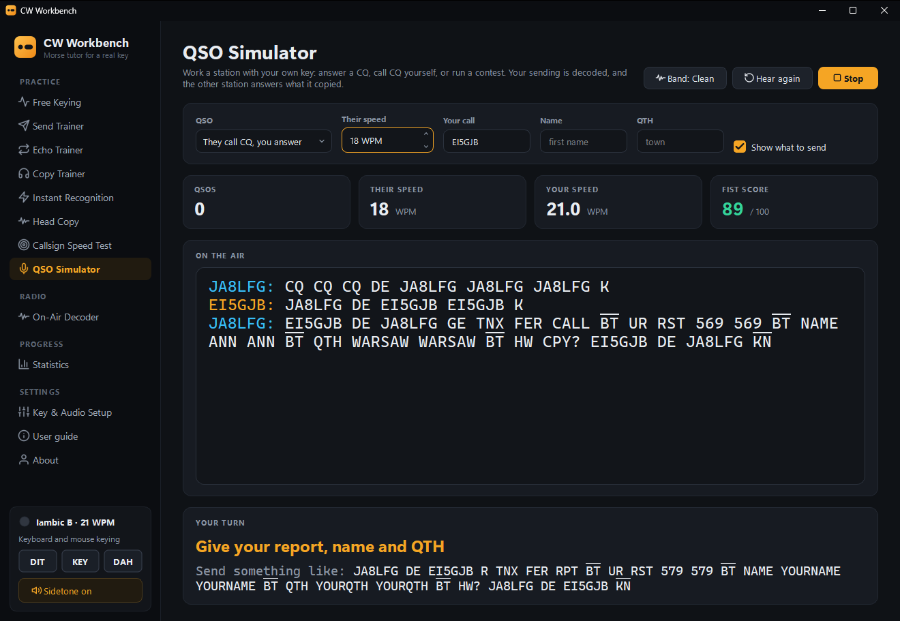
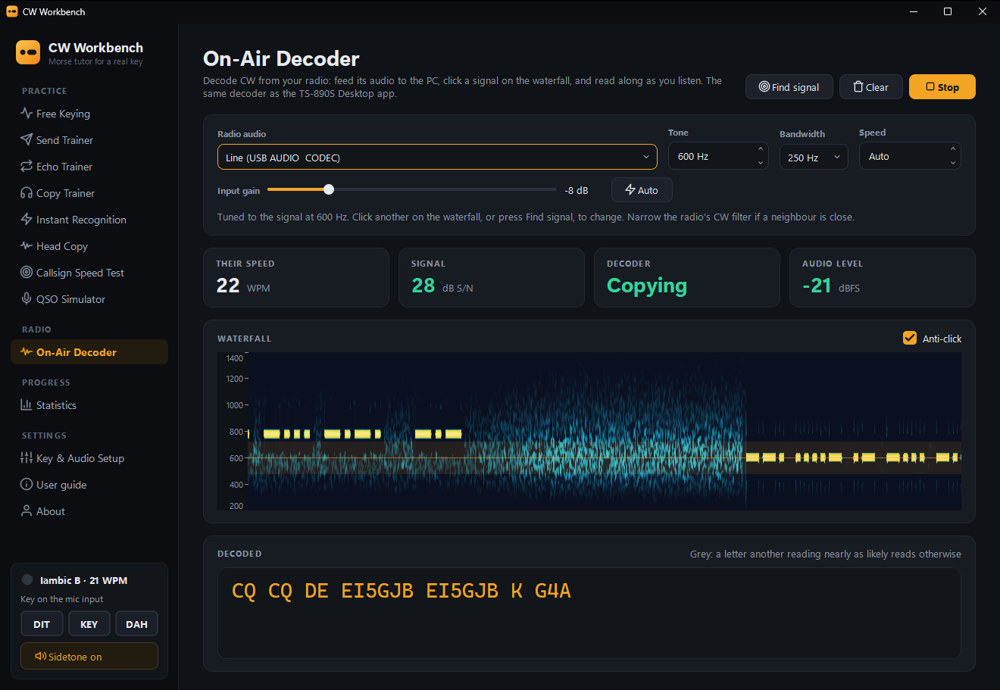
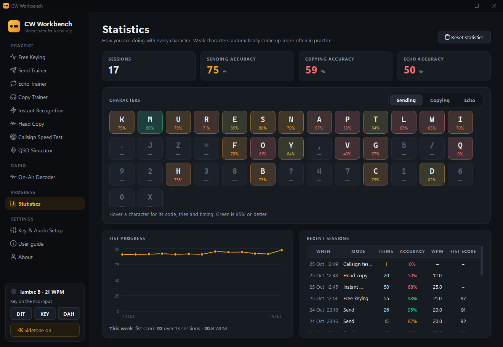

  

<h1 align="center">CW Workbench</h1>

  <b>A free Morse tutor for Windows that works with your own key.</b> 
  Plug a straight key, bug or paddle into the PC's microphone socket and practise sending,
  copying and keying back, with a proper sidetone and a look at every letter you send.

  <a href="https://github.com/lmacc/CW-Workbench/releases/latest"><b>⬇ Download the latest version</b></a>
  &nbsp;·&nbsp; Windows 10 and 11 (64-bit)

## Why I wrote it

Most practice programs either play Morse at you or have you tapping a keyboard key, and
neither feels like the real thing. CW Workbench listens to the key you actually use on the
air, plugged into the PC with an ordinary 3.5 mm plug. There's no interface box and no USB
adapter to buy.

It hears the key through the mic socket and calibrates itself to your sound card. It has an
iambic keyer built in (modes A and B), and the sidetone follows your key within about 10 ms,
so it feels like keying a radio. Every letter you send is drawn over its perfect timing, and
your fist gets a score for dah:dit ratio, spacing and steadiness.

## What you can do with it

- **Free Keying.** Send whatever you like and watch it decoded. Play back your last few words
  as you sent them, next to the same words sent perfectly.
- **Send Trainer.** Words, callsigns, Q-codes and QSO phrases, checked letter by letter.
- **Echo Trainer.** Hear it, then key it straight back.
- **Copy Trainer.** The Koch method, one new character at a time. Lessons can be saved as
  MP3 to practise in the car or out walking.
- **Instant Recognition.** One character at full speed, typed the moment you know it.
- **Head Copy.** A word or phrase at full speed, and you only get to type it once it's over.
- **Callsign Speed Test.** Along the lines of RufzXP: the speed climbs as long as you keep
  getting them right.
- **QSO Simulator.** Work a made-up station with your own key. Answer a CQ, call CQ, or run
  a contest. It replies to what it actually decoded from your sending.
- **On-Air Decoder.** Decodes CW off the air from your radio's audio, with a waterfall like
  CW Skimmer's, so you can check your copy against it.

There's a Coach that turns your timing into tips in plain words, with extra help for bugs
and sideswipers. The copying trainers can add band conditions (noise, fading, a station
alongside, chirp, and senders with less than perfect fists), and the statistics keep track of
every character, so the ones you get wrong come up more often.

## Download and install

1. Go to the **[latest release](https://github.com/lmacc/CW-Workbench/releases/latest)** and
   download **`CWWorkbench-Setup-<version>.exe`**.
2. Run it. It installs for your own Windows account without needing admin rights, and puts
   **CW Workbench** and the **CW Workbench User Guide** in the Start menu.
3. If Windows says **"Windows protected your PC"**, click **More info**, then **Run anyway**.
   The installer isn't code-signed, so Windows doesn't recognise it yet.

To update, run the newer installer over the old one; your settings and statistics are kept.
From 0.3.0 on, the **About** button in the app lights up when there's a new version out. To
remove it, go to **Settings → Apps → Installed apps → CW Workbench → Uninstall**.

## Connect your key

| Key | Tip | Ring | Sleeve |
|---|---|---|---|
| Straight key, bug, sideswiper | key contact | not used | common |
| Iambic paddle | dit | dah | common |

On a desktop PC, use the pink microphone socket. A laptop with one headset socket needs a
headset splitter cable, with the key plugged into its microphone side. A paddle needs a
stereo microphone input. Plenty of PCs have one, and the app tells you if yours doesn't.

> **It won't hurt your PC.** The mic socket only puts a few volts through a resistor, so
> closing a key across it is harmless. **Just never have the same key connected to a radio
> at the same time.**

## First start

1. The app opens on **Key & Audio Setup**. Choose the microphone input your key is plugged
   into and tick **Read my key from this input**.
2. Press **Calibrate**. Keep your hands off the key for a moment, then press and hold it,
   then let go. It takes about 7 seconds (12 for a paddle).
3. On **Keyer & sound**, choose your key type, keyer speed and sidetone.
4. Go to **Free Keying** and start sending.

No key yet? The keyboard works too: **Space** is a straight key, and **Ctrl** or **[ ]** are
the paddles. There are on-screen keys as well.

For every page and setting in detail, and a troubleshooting section, open the **User guide**
from the app's sidebar or the Start menu.

## Requirements

- Windows 10 or 11, 64-bit
- A microphone socket, or a USB sound adapter with one
- Headphones or speakers for the sidetone
- For the On-Air Decoder, a radio with USB audio, or a cable from its audio out to the PC

## Feedback

Found a problem, or have an idea? Please
[open an issue](https://github.com/lmacc/CW-Workbench/issues). If it's about picking up the
key or the sound, the app keeps a log at `%APPDATA%\CWWorkbench\CW Workbench\audio-log.txt`
that helps a lot.

73, Leslie EI5GJB
